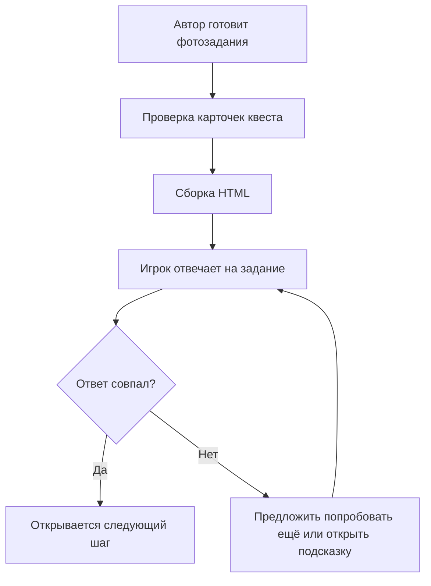

# 216 · Городской фотоквест

Репозиторий `city-photo-quest` · браузерное приложение

**Продукт и интерфейс.** Автор добавляет фотографии деталей города, вопросы, подсказки и варианты ответов. Игрок открывает задания по порядку, вводит ответ и видит прогресс. Квест можно скачать и открыть в браузере на телефоне.

**Архитектура и данные.** TypeScript хранит набор упорядоченных заданий с локальными изображениями. Ответы сравниваются после нормализации регистра и пробелов, принимаются заданные автором варианты. Экспорт собирает отдельный HTML-файл с изображениями. Черновики и прогресс хранятся локально. Сервер, GPS и распознавание фото не нужны.

**Блок-схема основного сценария**

**Функциональные правила.** На каждом шаге хранить открытое задание и число попыток. Перед сравнением применять одинаковую нормализацию к вводу и заданным вариантам. После верного ответа открыть следующий шаг, после последнего показать завершение.

**Контракты реализации.** Модули `quest-editor`, `answer-checker`, `player-progress` и `quest-export`. Прогресс ключуется по идентификатору пакета, изображения и текст экспортируются в страницу вместе с проигрывателем.

**Проверки граничных случаев.** Проверить пробелы и регистр, русские символы, подсказку и отсутствие интернета после открытия выгруженного квеста.

**Разработка и приёмка.** Сделать редактор и формат данных, затем режим игрока, подсказки и самостоятельный экспорт. Собрать три задания, открыть экспорт в другом браузерном профиле, убедиться, что неверный ответ не открывает следующее задание, а допустимый вариант принимается.
